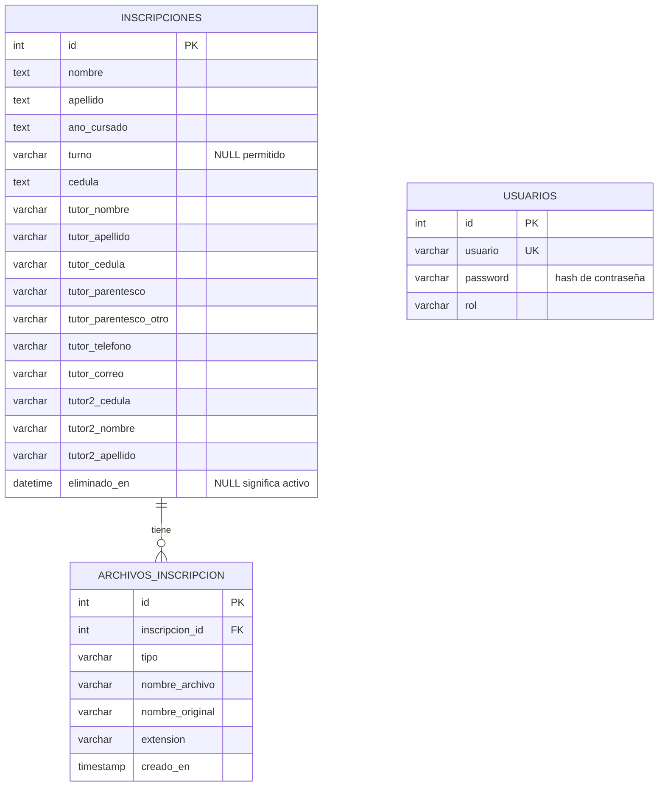

# Sistema de gestión escolar

Aplicación web para administrar expedientes escolares. Está construida con
Flask, MySQL y Waitress, y puede usarse desde otras computadoras de la misma
red local.

## Funciones principales

- Consulta de expedientes y listados por grado y sección.
- Filtros combinables por columna en los listados de grado.
- Impresión de las filas visibles después de aplicar filtros.
- Exportación a Excel de todos los registros del grado, aunque haya filtros
  activos en la página.

## Requisitos

- Windows
- Python 3.14.8 (versión verificada; otras versiones aún no están certificadas)
- Las dependencias de `requirements.txt`
- XAMPP (servicio MySQL)

## Instalación rápida

1. Instala Python 3.14.8 y XAMPP en la computadora que alojará el sistema.
2. Abre una terminal en esta carpeta e instala las dependencias:

   ```powershell
   python -m pip install -r requirements.txt
   ```

3. Inicia MySQL desde el panel de XAMPP. Para una instalación nueva, crea la
   base `escuela_ebngru` e importa `escuela_db.sql`. Para migrar datos
   existentes, sigue el procedimiento de
   [migración en Windows](INSTALACION_ANFITRION_WINDOWS.md#migrar-una-instalacion-existente).
4. Copia `config.example.json` como `instance\config.json` y completa la
   configuración de MySQL. Genera una clave secreta con:

   ```powershell
   python -c "import secrets; print(secrets.token_urlsafe(48))"
   ```

   Usa el resultado como `secret_key`. No compartas ni subas
   `instance\config.json`: contiene credenciales y una clave privada.
5. Inicia la aplicación:

   ```powershell
   python proyecto.py
   ```

La guía con los pasos detallados para instalar, migrar datos y configurar el
acceso en Windows está en [INSTALACION_ANFITRION_WINDOWS.md](INSTALACION_ANFITRION_WINDOWS.md).
El esquema y las relaciones de la base de datos se describen en
[la sección Modelo entidad-relación](#modelo-entidad-relación).

## Acceso

- En la computadora anfitriona: <http://127.0.0.1:5000>
- En otra computadora de la misma red: `http://IP-LOCAL-DEL-ANFITRION:5000`

Para conocer la IP que deben usar los demás equipos, ejecuta `ipconfig` en la
computadora anfitriona y busca la dirección IPv4 de su conexión activa. La
ventana de la terminal debe permanecer abierta mientras se usa la aplicación;
pulsa `Ctrl+C` en ella para detener el servidor.

## Nota de seguridad

Waitress sirve la aplicación por HTTP, sin cifrar el tráfico. Úsala solo en
una red local privada y confiable; no expongas el puerto 5000 a Internet.

Al cargar archivos manualmente en GitHub, `.gitignore` no los excluye
automáticamente. No subas `instance\config.json` ni archivos de
`instance\uploads`, porque pueden contener credenciales y documentos escolares.

# Modelo entidad-relación

Este documento describe el esquema que usa actualmente el sistema, según
`escuela_db.sql` y las consultas de `INSCRIPCIÓN DE ESTUDIANTES.py`. No incluye
datos reales ni valores de configuración.

## Diagrama



## Entidades y relaciones

### `inscripciones`

Contiene los expedientes de estudiantes, su grado/sección, turno, cédula y los
datos de uno o dos representantes. `id` es la clave primaria autoincremental.
`eliminado_en` implementa la papelera: `NULL` indica una inscripción activa y
una fecha indica que fue retirada.

Todos los campos son `NOT NULL` salvo `turno` y `eliminado_en`. Los campos de
representantes tienen valores predeterminados como `No registrado`.

Los datos de los representantes están guardados directamente en esta tabla;
no existe una tabla independiente de representantes. El esquema actual admite
campos para un representante principal y un segundo representante.

### `archivos_inscripcion`

Contiene los metadatos de cada adjunto. `inscripcion_id` es una clave foránea
hacia `inscripciones.id`. La relación es de **una inscripción a cero o muchos
archivos**; cada registro de archivo pertenece a una sola inscripción.

El contenido del archivo no está guardado en MySQL: se conserva como archivo
físico en `instance/uploads`. `nombre_archivo` identifica el nombre guardado en
disco y `nombre_original` conserva el nombre presentado al usuario. Por eso,
una copia de seguridad completa también debe incluir esa carpeta.

La aplicación envía las inscripciones a la papelera mediante una actualización
de `eliminado_en`; esto no elimina los metadatos ni los archivos adjuntos. La
clave foránea sí especifica `ON DELETE CASCADE` para un borrado físico de la
inscripción.

### `usuarios`

Almacena las cuentas que inician sesión en la aplicación. `usuario` es único y
`password` guarda hashes de contraseña (las cuentas iniciales usan scrypt). La
aplicación convierte formatos heredados a hash cuando el usuario inicia sesión
correctamente. Esta tabla no tiene una relación de clave foránea con
`inscripciones`: el sistema no registra qué usuario creó o modificó cada
expediente.

## Límites del modelo actual

- Grado/sección y turno se guardan como texto, no como claves a tablas
  separadas.
- Los representantes son columnas dentro de `inscripciones`, en vez de filas
  en una tabla propia.
- Los adjuntos dependen tanto de su fila en `archivos_inscripcion` como del
  archivo físico en `instance/uploads`.
- La tabla de adjuntos no impone una restricción única por inscripción y tipo
  de archivo; esa regla la gestiona la aplicación al reemplazar adjuntos.
